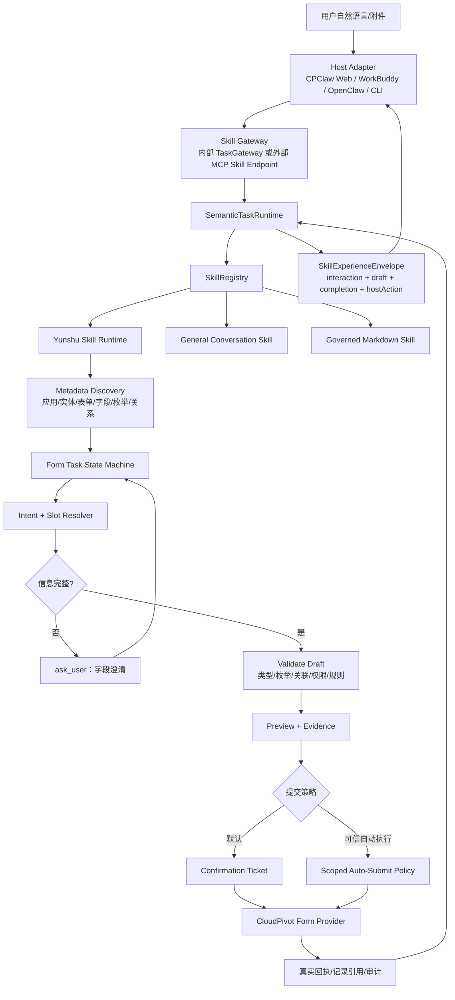

# CPClaw 丝滑对话式技能与智能填单架构

## Problem Statement

当前“我要新增一个线索，名称是大海电子科技有限公司”被识别为粗粒度 `create_data`，随后直接返回“请回到 CPClaw 确认影响范围”。系统没有先定位云枢表单、读取字段定义、判断已提供和缺失的信息、生成草稿，也没有形成“补充信息 → 校验 → 预览 → 提交”的连续任务。因此确认卡片虽然存在，但没有承载真正的填单业务。

问题本质是把“表单任务”错误建模成了“写接口确认任务”。确认只是提交前的一个状态，不应是填单流程的起点。

## User Intent

用户希望 CPClaw 成为统一对话入口，同时提供三类能力：

1. 云枢技能：基于云枢元数据完成查询、分析、智能填单、流程待办和受控操作。
2. 通用技能：不需要云枢数据时，提供普通大模型对话服务。
3. Markdown 技能：接入其他经过治理、可审核、可绑定服务端执行器的技能。

同一套云枢技能还要能被 WorkBuddy 等外部 AI 工具直接调用。外部 AI 工具不是 CPClaw 的二级界面，也不能要求用户跳回 CPClaw；它必须直接接入云枢 Skill，独立完成澄清、字段草稿、确认、提交和结果表达。CPClaw Web 只是该 Skill 的一个宿主。

## Success Criteria

- 用户说“新增一个线索，名称是大海电子科技有限公司”后，系统能从已同步元数据中定位唯一表单/业务对象，并显示已识别字段。
- 缺少必填字段时，只追问当前最重要的 1–3 个字段；用户补充后继续同一个任务，不丢失已填写内容。
- 字段值经过类型、枚举、关联对象、权限和业务规则校验；无法确定的值标记为待确认，不静默猜测。
- 表单草稿可编辑、可回退、可重新校验，并展示每个字段的来源：用户输入、附件提取、上下文引用、系统默认或 AI 建议。
- 信息完整后，系统生成提交预览，明确对象、字段变更、影响范围和风险；默认由用户确认后提交。
- 提交成功必须返回真实回执、记录引用和审计信息；失败必须可解释且不伪装成功。
- CPClaw Web、WorkBuddy、其他 OpenClaw 类宿主和 CLI 对同一 Skill 使用同一状态、草稿、确认票和结果契约；外部宿主不依赖 CPClaw UI。
- 普通闲聊不访问云枢；未安装或未批准的 Markdown Skill 不可执行。

## Constraints

- CPClaw 框架不得固化具体业务对象、行业词、字段别名或场景风险规则；这些内容来自 Skill 元数据或审核通过的模板。
- 云枢对象、表单、字段、枚举、关联和操作必须来自最近一次有效同步或已验证 API 契约。
- 模型只能提出候选理解、字段映射和表达，不能直接获得任意 URL、SQL、凭据或执行器。
- 写入仍受权限重验、幂等、确认、审计和有效期约束；确认必须能在调用方宿主内完成，不能以“回到 CPClaw”作为协议前提。
- 用户提出的“自动提交”与当前安全基线存在冲突：默认体验应自动完成准备和校验，但提交动作仍需要一次明确确认；若要无确认自动提交，必须另设可信自动执行策略、范围和撤销/审计机制。
- 当前真实云枢新增/更新/表单提交契约尚未完成 E2E 验证，不能把方案描述成已交付能力。

## Options Explored

### Option A: 继续沿用粗粒度写操作确认

识别到新增/修改后直接创建确认单，确认后调用写接口。实现成本低，但无法解决表单定位、字段补全、草稿编辑和字段校验，不能满足丝滑填单体验。

### Option B: 在云枢 Skill 内增加表单任务状态机（选定）

将表单识别、字段槽位、草稿、校验、预览和提交建模为统一任务对象；平台负责生命周期、身份、确认、审计和宿主交付，云枢 Skill 负责元数据驱动的表单语义与 Provider 调用。Web 与 WorkBuddy 共享同一任务状态机，仅在交互渲染上不同。

### Option C: 让 WorkBuddy/前端自行编排表单步骤

由各宿主自己识别字段、保存草稿并调用多个 MCP 工具。看似灵活，但会产生多套业务语义、状态和安全逻辑，宿主之间容易出现事实不一致，也违背 CPClaw 统一 Runtime 目标。

### Selected: Option B

选择 Option B，因为“丝滑”要求的是一次连续任务体验，而不是更多接口。表单任务状态机能把澄清、草稿、校验、确认和执行连成一个可恢复、可审计的闭环，同时保留平台与云枢 Skill 的边界。

## Architecture Sketch

## Key Decisions

1. **能力分类**：平台注册三类 Skill：`yunshu`、`conversation`、`markdown`。Skill 选择由能力声明和上下文决定，不能由框架业务词表硬编码。
2. **表单任务是一等对象**：新增 `FormTask` 概念，至少包含 `taskId`、`skillId`、`formRef`、`metadataVersion`、`state`、`slots`、`draft`、`missingSlots`、`validationIssues`、`confirmationId`、`idempotencyKey` 和 `auditRef`。
3. **状态机**：`UNDERSTAND → FORM_DISCOVERED → COLLECTING → DRAFT_READY → VALIDATING → READY_TO_SUBMIT → CONFIRMATION_REQUIRED → SUBMITTING → SUBMITTED/FAILED`。补充信息只续接当前任务，不新建无上下文任务。
4. **槽位与字段映射**：每个字段记录 `fieldCode`、显示名、值、类型、来源、置信度、是否必填、是否已确认和校验状态。AI 只负责候选映射，服务端按元数据确定是否可接受。
5. **渐进式追问**：一次只问阻塞当前提交的最小字段集合；对于可选字段给出“跳过/使用建议值/修改”的选择，避免一次展示整张表单。
6. **草稿与预览**：草稿先持久化在 CPClaw，不立即写云枢。用户可以在对话中自然修改，也可以通过结构化卡片编辑；任何字段变化都会使旧校验和确认票失效。
7. **提交策略**：默认自动完成表单识别、字段补全、校验和提交预览；提交动作需一次明确确认。可信自动提交是单独的管理员策略，必须限定 Skill、对象、字段、用户、金额/影响范围、有效期和可审计开关。
8. **Provider 契约**：云枢 Provider 新增 `loadFormSchema`、`validateDraft`、`createRecord`、`updateRecord`、`submitAction` 等明确能力；未验证契约保持 `blocked`，不能用删除接口或泛化业务规则替代。
9. **Skill 直接对外**：外部宿主连接的是版本化的 Yunshu Skill Gateway/MCP Endpoint，而不是 CPClaw 对话 API。CPClaw Web 内部也通过同一 Skill Runtime 调用，不能形成第二套语义执行器。
10. **宿主内交互闭环**：`SkillExperienceEnvelope` 的 `interaction` 必须支持 `ask_user`、`draft_form`、`validation_error`、`confirmation`、`result`。WorkBuddy 收到 `confirmation` 后，在自身对话界面取得用户确认，再把签名确认票和草稿版本提交回 Skill；不跳转 CPClaw，不调用 CPClaw UI。
11. **外部宿主能力协商**：连接初始化时声明是否支持结构化表单、按钮回调、确认回调、流式事件和任务恢复。若宿主不支持这些能力，只能降级为文本/JSON 交互，不能宣称与 CPClaw 同等丝滑。
12. **数据分析复用同一原则**：分析任务也应先形成数据需求计划，再并行获取主对象、关联对象和所需字段，最后由确定性计算器生成指标，模型只负责解释和表达。
13. **Markdown Skill 治理**：Markdown 只声明能力、输入输出、风险和执行器绑定，不携带脚本、URL、凭据或任意代码；必须经过草稿、审核、发布后才能进入 Registry。

## Open Questions

- 当前真实云枢表单 schema、保存/提交接口的最终请求结构和错误码是什么？需要真实租户探查与契约固化。
- “默认确认提交”是否满足业务要求？若必须无确认提交，需要先定义可信自动执行策略及管理员开关。
- 表单字段中哪些值允许由用户历史记忆或附件提取自动填充？敏感字段和高风险字段是否必须逐项确认？
- WorkBuddy 当前是否支持结构化表单卡片、按钮回调和 continuation token？若不支持，必须先实现 Skill Gateway 的文本/JSON 交互协议；不能退回“跳转 CPClaw”作为替代方案。
- 多应用、多表单联动时，是否先完成只读数据准备，再集中确认多个写入节点？

## Next Steps

1. 先用真实云枢只读元数据确认“表单、字段、枚举、关联、必填和动作”的可获取范围。
2. 冻结 `FormTask`、槽位、草稿、校验问题、交互事件和 continuation 契约。
3. 将当前 `create_data/update_data` 路径拆为“表单任务识别”和“提交动作”两个阶段；未完成真实 Provider 契约前，先实现安全澄清和草稿，不宣称提交完成。
4. 为 Web 和 MCP/WorkBuddy 各做一条完整验收链：少信息追问、多轮补全、草稿修改、字段校验、确认提交、重复请求和失败恢复。
5. 再进入实现计划，按控制面、执行面、数据模型、宿主交互和回归测试分阶段实施。

## Review Gate（开发前必须通过）

本方案在以下证据齐全前保持 `review-gate`，不得标记为已完成或直接进入代码改造：

| Gate | 必须提供的证据 | 失败处理 |
| --- | --- | --- |
| G1 独立 Skill | 独立 Gateway 的端点、认证、版本、部署和审计设计评审记录 | 回退架构设计 |
| G2 统一协议 | `TaskExperienceEnvelope`、状态机、continuation、宿主内确认的契约测试 | 禁止开发宿主专用分支 |
| G3 云枢真实契约 | 表单 Schema、validate/create/update/submit、错误码、幂等和回查 E2E | 仅开放草稿/预览 |
| G4 身份安全 | OIDC/JWT、租户隔离、权限映射、确认票绑定和重放测试 | 禁止外部写入 |
| G5 跨宿主体验 | CPClaw Web 与模拟 WorkBuddy 完成追问→提交→恢复→幂等闭环 | 继续修订协议 |

通过第 24 号 Definition of Ready 后，产品状态可从 `review-gate` 变更为设计层 `implementation-ready` 并进入受控开发；G0-G6 是真实写入与生产交付门禁，不通过时只能交付只读、草稿或预览能力。
